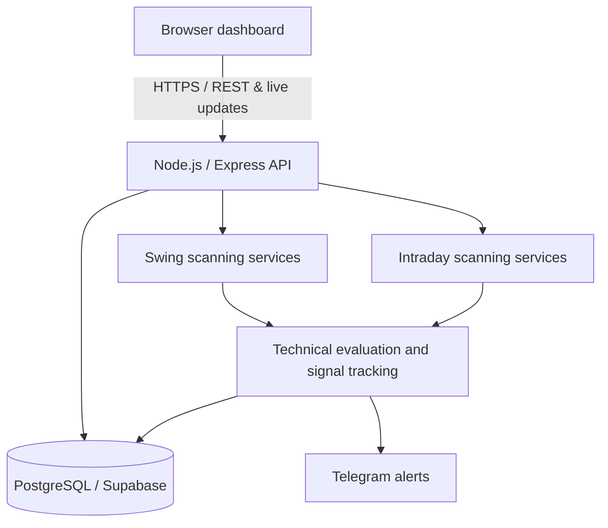

# AnkQuant
### Stock Market Intelligence & Signal Scanner

**Intraday and swing market scanning · Technical signal confluence · Interactive market dashboards**

## Overview

**AnkQuant** is a full-stack market intelligence platform focused on identifying and monitoring potential opportunities in Indian equities. It combines intraday and swing scanning, technical indicator evaluation, signal tracking, and risk-oriented paper-trading workflows in a single web experience.

Explore the running application at **[ankquant.in](https://ankquant.in)**.

> **Portfolio showcase:** This repository documents the project without distributing its proprietary application source code or detailed strategy parameters.

## Features

- **Intraday scanner:** Monitors short-term market activity and technical setups.
- **Swing scanner:** Reviews daily-market setups with a distinct evaluation workflow.
- **Multi-signal analysis:** Uses technical indicators, price action and confluence checks to surface candidate opportunities.
- **Signal dashboard and journal:** Provides market views, signal history and analysis interfaces.
- **Paper-trading workflows:** Tracks simulated positions and risk-management outcomes; does not automatically place broker orders.
- **Alerts:** Integrates Telegram notifications for selected market events.
- **Durable history:** Uses database-backed storage for applicable signals, states and journals.
- **Operational reliability:** Includes automated tests and deployment tooling.

## Technology

| Layer | Technologies |
| --- | --- |
| Backend | Node.js, Express.js, JavaScript |
| Frontend | HTML, CSS, ReactJs |
| APIs and live updates | REST endpoints, Server-Sent Events (SSE), WebSockets where applicable |
| Database | PostgreSQL via Supabase |
| Market analysis | Custom technical-indicator and signal-evaluation logic |
| Notifications | Telegram integration |
| Deployment and testing | Docker, Render configuration, automated test suites |

## Architecture at a glance

This is a high-level, portfolio-safe illustration, not a disclosure of proprietary strategy rules or production configuration.

## Product preview

Visit **[ankquant.in](https://ankquant.in)** to explore the public-facing experience.

Screenshots can be added here later after checking that they contain no account identifiers, personal trading information or sensitive configuration.

## Engineering focus

AnkQuant demonstrates work in backend services, scheduled processing, indicator-driven data analysis, state persistence, live-update mechanisms, API design, automated testing and production deployment.

More information: [Project features](docs/FEATURES.md) · [Architecture overview](docs/ARCHITECTURE.md)

## Source-code policy

The production codebase is maintained in a **private GitHub repository** to protect proprietary algorithms, credentials and implementation details. This repository is a public, documentation-only showcase. It is **not** the application's source repository.

## Disclaimer

AnkQuant presents market analysis and simulated trade-management features for informational and research purposes. Signals are not guaranteed outcomes or personalized financial advice. Trading involves financial risk.

---

**Created and maintained by [Ankit1433](https://github.com/Ankit1433).**
